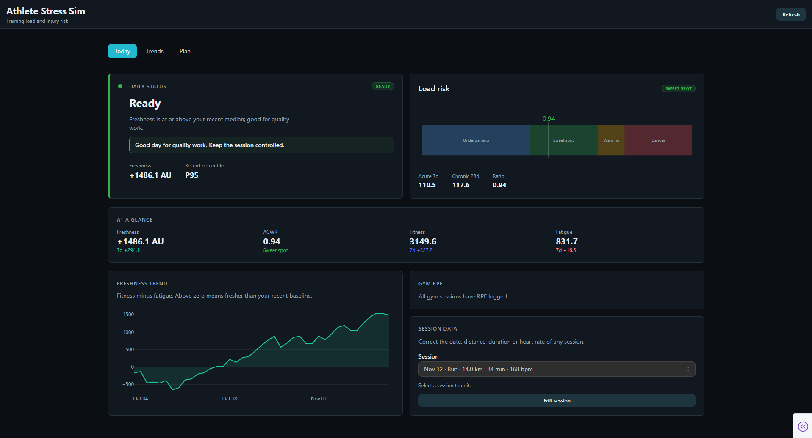
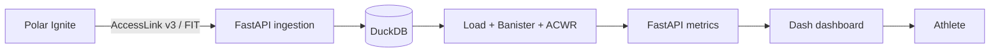
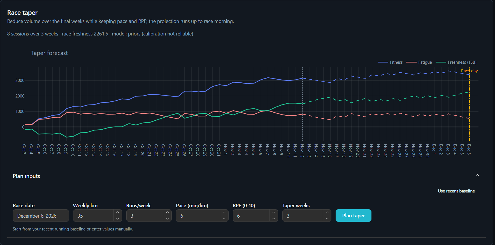
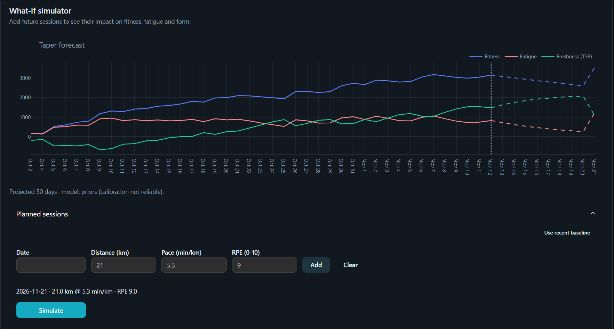
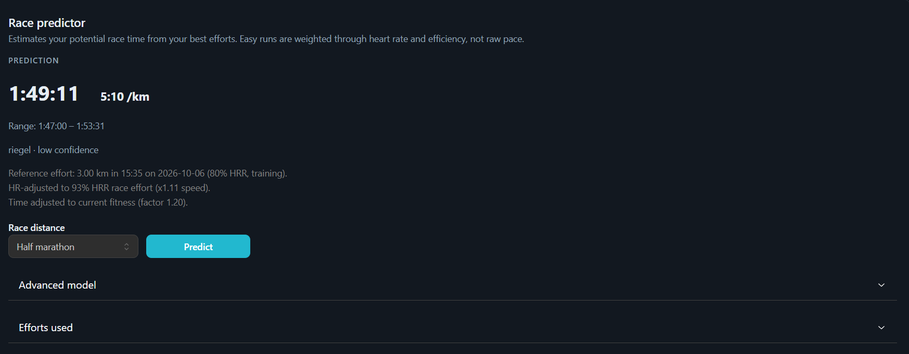

# Athlete Stress Sim

<h3 align="center">Local-first training-load, fitness-fatigue and race-readiness platform</h3>

<div align="center">

[](https://github.com/Alejandro-Vallejo-Mayo/athlete-stress-sim/actions/workflows/ci.yml)
[](https://www.python.org/)
[](https://docs.astral.sh/uv/)
[](https://duckdb.org/)
[](https://fastapi.tiangolo.com/)
[](https://dash.plotly.com/)
[](https://opensource.org/licenses/MIT)

<br />



</div>

Athlete Stress Sim turns **Polar Ignite** telemetry into a daily internal-load
series and uses it to estimate **fitness, fatigue, overload risk and race
readiness**. It combines heart-rate TRIMP for running and elliptical sessions with
session-RPE for strength work, fits a Banister fitness-fatigue model, and exposes
the results through a FastAPI backend and a dark Dash/Mantine dashboard.

The project was built as a personal tool for a first half marathon with a hybrid
routine of **three running days and three gym days per week**. It is also a
portfolio project about building an end-to-end, reproducible and honest
data/physiology pipeline.

> **This is not medical advice.** The metrics are monitoring and planning aids,
> not diagnoses. They do not replace professional assessment.

---

## Contents

- [What it does](#what-it-does)
- [Why this exists](#why-this-exists)
- [Feature highlights](#feature-highlights)
- [Architecture](#architecture)
- [Mathematical core](#mathematical-core)
- [Dashboard tour](#dashboard-tour)
- [Quick start](#quick-start)
- [Usage](#usage)
- [Engineering highlights](#engineering-highlights)
- [Validation and results](#validation-and-results)
- [Testing and quality](#testing-and-quality)
- [Documentation](#documentation)
- [Limitations and scope](#limitations-and-scope)

---

## What it does

- **Ingests** Polar AccessLink sessions through an idempotent catch-up sync and
  parses FIT telemetry second by second.
- **Quantifies load** with Banister TRIMP for running/elliptical sessions and
  Foster session-RPE for strength sessions.
- **Models fitness-fatigue** with the Banister ODE and an NLS-style calibration
  that fixes the time constants, uses bounded ridge least squares and accepts a
  fit only if it passes a cross-validation gate.
- **Estimates overload risk** with the acute:chronic workload ratio (ACWR) using
  exponentially weighted moving averages.
- **Visualizes the state** in a Today/Trends/Plan dashboard with readiness, ACWR,
  fitness-fatigue, aerobic decoupling, recent sessions and data-quality tools.
- **Plans the race** with a what-if simulator, an automatic race-taper planner and
  a race-time predictor based on Riegel, critical speed or heart-rate
  extrapolation.
- **Keeps data local** in DuckDB and runs as two reproducible Docker services.

---

## Why this exists

Weekly kilometers or total training minutes are easy to count, but they do not
capture the physiological cost of a session or the accumulation of fatigue across
weeks. A hard gym block, a long run and an easy elliptical session can look
similar in duration while producing very different internal load.

The project started from a concrete problem: preparing for a first half marathon
while lifting three times per week, with no clear way to decide whether the next
week should progress, hold or taper. The system answers that question with a
transparent model, a local database and a dashboard that shows both the current
state and the uncertainty behind it.

---

## Feature highlights

| Area | What is implemented |
| --- | --- |
| **Polar ingestion** | OAuth2 Authorization Code flow, token refresh, catch-up sync, FIT download and parsing |
| **Activity handling** | Running, strength, elliptical and other; elliptical contributes load but is excluded from running-only metrics |
| **Load model** | Banister TRIMP integrated over heart-rate samples; Foster session-RPE for strength |
| **Fitness-fatigue** | Banister ODE with exact daily recurrence and a `solve_ivp` numerical cross-check |
| **Calibration** | Fixed `tau`, bounded ridge least squares, leave-one-out CV gate and safe fallback to priors |
| **Risk** | Acute 7-day / chronic 28-day EWMA ACWR with four risk zones |
| **Dashboard** | Today, Trends and Plan tabs; dark Mantine theme; server-side data access |
| **Planning** | What-if simulator, race-taper plan, running baseline |
| **Running analysis** | Per-kilometer efficiency factor and aerobic decoupling |
| **Race prediction** | Riegel, critical speed and heart-rate extrapolation with confidence and range |
| **Data quality** | RPE pending modal, session editor, explicit offline/empty states |
| **Delivery** | `uv` lockfile, Makefile, Docker Compose, GitHub Actions, 80 % core-coverage gate |

---

## Architecture



The system runs as two processes:

1. **FastAPI backend** (`:8000`) owns Polar OAuth2, ingestion, DuckDB access,
   metrics, simulations and prediction.
2. **Dash frontend** (`:8050`) is a server-side HTTP client of the backend. The
   browser never reads DuckDB directly.

The design is intentionally local-first: biometric data stays in
`data/athleta.duckdb`, raw FIT files stay in `data/raw/`, and Docker images
contain runtime dependencies only. The architecture, data model, caching strategy
and failure modes are documented in [`docs/architecture.md`](docs/architecture.md).

### Tech stack

| Layer | Technology |
| --- | --- |
| Language | Python 3.12 |
| Environment | `uv` + `pyproject.toml` + `uv.lock` |
| Ingestion | `httpx2`, Polar AccessLink v3, `fitparse` |
| Storage | DuckDB |
| Numerical core | NumPy, SciPy |
| API | FastAPI + Pydantic v2 + Uvicorn |
| Dashboard | Plotly Dash + Dash Mantine Components |
| Quality | pytest, pytest-cov, ruff, mypy, pre-commit |
| Delivery | Docker Compose, GitHub Actions |

---

## Mathematical core

The production model is documented in detail in
[`docs/mathematical-model.md`](docs/mathematical-model.md), including assumptions,
worked examples and scientific references.

**Running/elliptical load** — Banister TRIMP integrated over the heart-rate series:

$$
TRIMP = \sum_i \Delta t_{\min} \cdot HR_{r,i} \cdot a e^{b HR_{r,i}}
$$

**Strength load** — Foster session-RPE:

$$
L_{\text{gym}} = RPE \cdot D_{\min}
$$

**Fitness-fatigue** — Banister recurrence:

$$
g_t = g_{t-1}e^{-1/\tau_1} + w_t
\qquad
h_t = h_{t-1}e^{-1/\tau_2} + w_t
$$

$$
F_t = k_1 g_t - k_2 h_t
\qquad
P_t = P_0 + F_t
$$

**Overload risk** — exponentially weighted ACWR:

$$
EWMA_t = \lambda L_t + (1-\lambda)EWMA_{t-1}
\qquad
\lambda = \frac{2}{N+1}
$$

$$
ACWR_t = \frac{EWMA_t^{\text{acute}}}{EWMA_t^{\text{chronic}}}
$$

The calibration path fixes `tau_1` and `tau_2`, estimates only the gains with
bounded ridge least squares, and accepts the fit only when both in-sample `R²` and
leave-one-out cross-validation improve over the prior-shaped baseline.

---

## Dashboard tour

The dashboard is organized around three questions: **how am I today?**, **how did
I get here?**, and **what should I do next?**

### Today

The hero capture above shows the **Today** view: readiness, freshness, ACWR,
at-a-glance stats, pending gym RPE and session-data correction.

### Trends

Fitness, fatigue and freshness over time, aerobic decoupling for a selected run,
and recent sessions with RPE status.


### Plan — Race taper

A progressive pre-race taper that reduces volume while preserving intensity and
projects freshness through race morning.



### Plan — What-if simulator

Add future sessions and see how they would affect fitness, fatigue and form.



### Plan — Race predictor

Estimate race potential from detected best efforts, with model, confidence and
support range.



> Capture guidelines and exact file names live in
> [`docs/assets/README.md`](docs/assets/README.md).

---

## Quick start

### Prerequisites

- Python 3.12 (3.11 is also allowed by the package metadata).
- [`uv`](https://docs.astral.sh/uv/).
- A Polar AccessLink client.
- Docker is optional.

### 1. Install

```bash
git clone git@github.com:Alejandro-Vallejo-Mayo/athlete-stress-sim.git
cd athlete-stress-sim
make install
```

### 2. Configure Polar

```bash
cp .env.example .env
```

Fill in:

- `POLAR_CLIENT_ID`
- `POLAR_CLIENT_SECRET`
- `POLAR_REDIRECT_URI` (default `http://localhost:8000/auth/callback`)

Create the AccessLink client at <https://admin.polaraccesslink.com/> and register
the same redirect URI. Then start the backend and open `GET /auth/login` to link
the account. `.env` is git-ignored and must never be committed.

### 3. Run locally

```bash
make run-backend    # API at http://localhost:8000, docs at /docs
make run-frontend   # dashboard at http://localhost:8050
```

Press **Refresh** in the dashboard to run the catch-up sync and load the metrics.

### Docker

```bash
make docker-up      # build and start backend + frontend
make docker-logs    # follow logs
make docker-down    # stop the services
```

Dashboard: <http://localhost:8050> · API: <http://localhost:8000> · API docs:
<http://localhost:8000/docs>.

### Useful commands

```bash
make lint
make typecheck
make test
make test-cov
make db
```

---

## Usage

- **Today:** check readiness, freshness, ACWR and at-a-glance values. Open the
  **Gym RPE** modal for strength sessions without RPE. Use **Session data** to
  correct a wrong date, distance, duration or heart rate.
- **Trends:** inspect the fitness-fatigue history, choose a run for aerobic
  decoupling, and review recent sessions.
- **Plan:** generate a race taper, simulate future sessions or estimate race
  potential.
- **Refresh:** sync new Polar sessions and reload the dashboard. If Polar is
  unreachable, local metrics still load and the UI shows a sync error.
- **API:** FastAPI exposes `/auth`, `/sync`, `/exercises`, `/metrics` and
  `/simulate`; the interactive contract is generated at `/docs`.

Full interpretation and troubleshooting live in
[`docs/user-guide.md`](docs/user-guide.md).

---

## Engineering highlights

- **Dual load model.** Heart-rate TRIMP and strength sRPE are combined into one
  daily load series, with elliptical sessions contributing global load while
  staying out of running-specific analyses.
- **Calibration with a quality gate.** The Banister model is identifiable only
  with enough data. The production path fixes the time constants, uses bounded
  ridge least squares, and falls back to priors unless in-sample `R²` and
  leave-one-out CV both pass. A fragile fit is never presented as personalized.
- **Performance-aware persistence.** Metrics use batch DuckDB reads, a
  revision-keyed snapshot cache and lightweight `SampleRow` tuples instead of
  constructing a Pydantic model for every telemetry second.
- **Local-first privacy.** Raw FIT files, the DuckDB database and biometric
  screenshots are not committed. Tokens and credentials live in local files, and
  the deployment assumes a trusted local network.
- **Fail-soft UI.** The dashboard handles an offline backend, failed sync, empty
  history and missing RPE without losing local data or showing fake values.
- **Reproducible delivery.** `uv.lock`, a Makefile, Docker Compose and GitHub
  Actions keep the environment and CI path explicit.

---

## Validation and results

The final validation snapshot is documented in
[`docs/validation.md`](docs/validation.md).

| Signal | Result |
| --- | --- |
| Real-data window | 2026-10-03 → 2026-11-12 (41 days) |
| Sessions | 31: 17 running, 13 strength, 1 elliptical |
| Telemetry | 93,011 samples; 31/31 sessions with samples |
| Strength RPE coverage | 13/13 (100 %) |
| Daily load coverage | 30 load days, 11 rest days |
| Calibration observations | 16 |
| Calibration result | Not accepted: `R² = 0.026`, CV improvement 28.3 %, priors used |
| Tests | 322 passed |
| Core coverage | 93.81 % (80 % gate) |
| API latency | `/metrics/banister` 335 ms cold, 60–70 ms warm |
| ODE runtime | 3,650-day recurrence in 0.65–1.08 ms |
| Dashboard | ~5.5 s → ~0.32 s warm load after S15 optimization |

> **Honest validation note:** the calibration improved cross-validated RMSE but
> failed the in-sample `R²` gate. The system therefore uses the physiological
> priors. This is intentional: the project reports an unstable fit instead of
> hiding it behind an optimistic number.

---

## Testing and quality

```bash
make lint       # ruff check + format check
make typecheck  # mypy --strict on src
make test       # pytest
make test-cov   # pytest + 80 % core-coverage gate
```

The suite uses synthetic FIT fixtures, injected HTTP transports and temporary
DuckDB databases. No test requires network access or real biometric data.

Coverage is enforced over `src/athlete_stress_sim/core`; backend and frontend are
covered by tests but excluded from the numerical gate.

---

## Project structure

```text
athlete-stress-sim/
├── src/athlete_stress_sim/
│   ├── backend/              # FastAPI app, routers, schemas, config
│   ├── core/
│   │   ├── etl/              # Polar OAuth, sync, FIT parser, normalization
│   │   ├── storage/          # DuckDB stores
│   │   ├── metrics/          # TRIMP, sRPE, ACWR, EF, taper, prediction
│   │   └── models/           # Banister ODE and calibration
│   └── frontend/             # Dash app, theme, readiness, components
├── tests/                    # unit, integration, frontend and performance tests
├── docs/                     # PRD, roadmap, architecture, math, validation, user guide
├── docker/                   # Dockerfiles and Compose topology
├── data/                     # local DuckDB + raw FIT files (git-ignored)
├── Makefile
├── pyproject.toml
└── uv.lock
```

---

## Documentation

| Document | What it covers |
| --- | --- |
| [`docs/product-requirements.md`](docs/product-requirements.md) | Product scope, requirement IDs, success criteria and as-built status |
| [`docs/roadmap.md`](docs/roadmap.md) | 16-week delivery plan, sprint status, risks and MoSCoW |
| [`docs/user-guide.md`](docs/user-guide.md) | Dashboard interpretation, configuration, endpoints and troubleshooting |
| [`docs/architecture.md`](docs/architecture.md) | Runtime topology, components, data model, flows and technical debt |
| [`docs/mathematical-model.md`](docs/mathematical-model.md) | Equations, calibration, assumptions and scientific references |
| [`docs/validation.md`](docs/validation.md) | Real-data snapshot, calibration diagnostics, performance and validity |
| [`docs/assets/README.md`](docs/assets/README.md) | Dashboard capture names and guidelines |

---

## Limitations and scope

- **Single user, local deployment.** There is no multi-user authentication, TLS
  or public hardening. Do not expose the API or dashboard to an untrusted
  network.
- **Polar-only ingestion.** The system uses Polar AccessLink v3 and a 30-day
  catch-up listing; webhooks and other devices are out of scope.
- **Calibration may fall back.** With short or noisy histories, the priors are
  the safe and intended outcome.
- **Combined load scale.** Running TRIMP and strength sRPE share arbitrary units;
  the series is useful for relative trends, not cross-modality equivalence.
- **No clinical claims.** ACWR, freshness and race prediction are signals, not
  diagnoses or guarantees.
- **Taper and prediction are heuristics.** The taper uses fixed volume factors and
  the race predictor extrapolates from training efforts; neither is a
  personalized physiological optimization.

---

## Status

**v1.0.0 — public release preparation.** The implementation, English
documentation, validation report and real-data checks are complete. The remaining
steps are the dashboard captures, the final secret review and the public release
tag. Delivery history and open items live in [`docs/roadmap.md`](docs/roadmap.md).

**Author:** Alejandro Vallejo Mayo — Double Degree in Mathematics and Computer
Engineering, University of Seville.

**License:** MIT.
