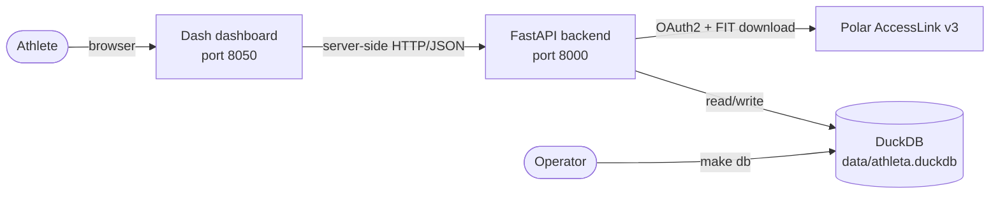
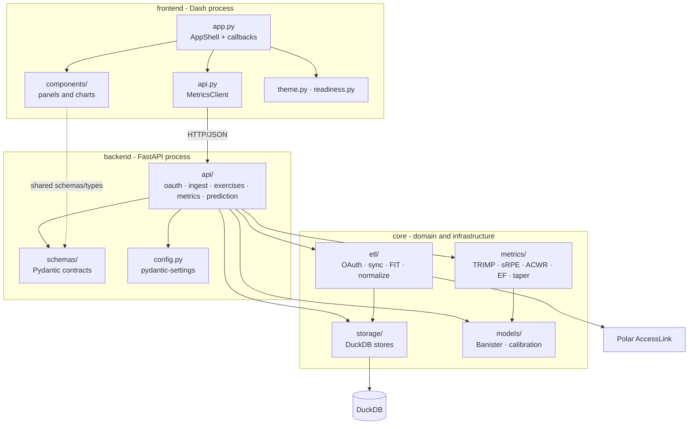
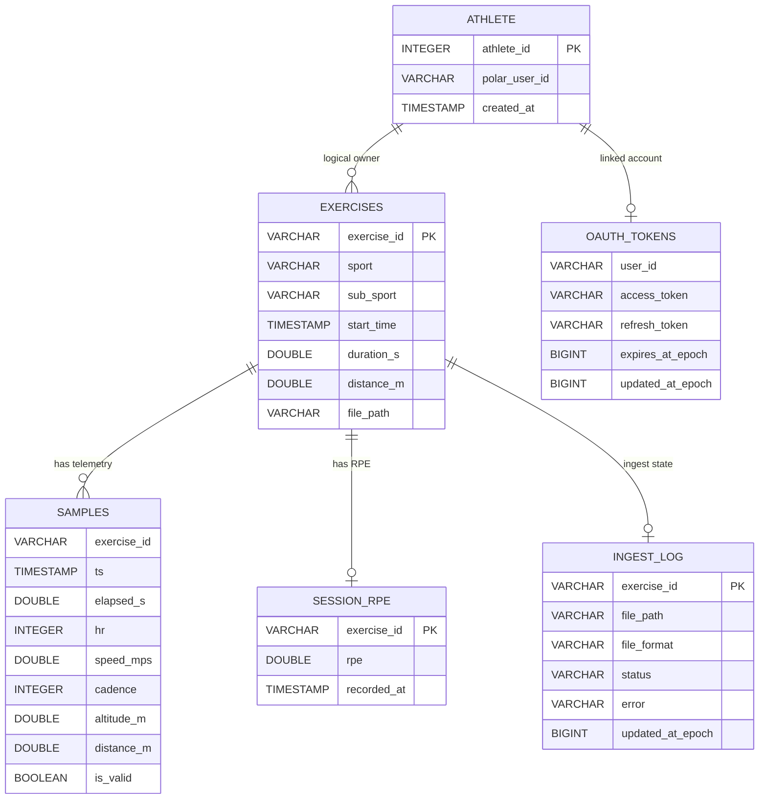
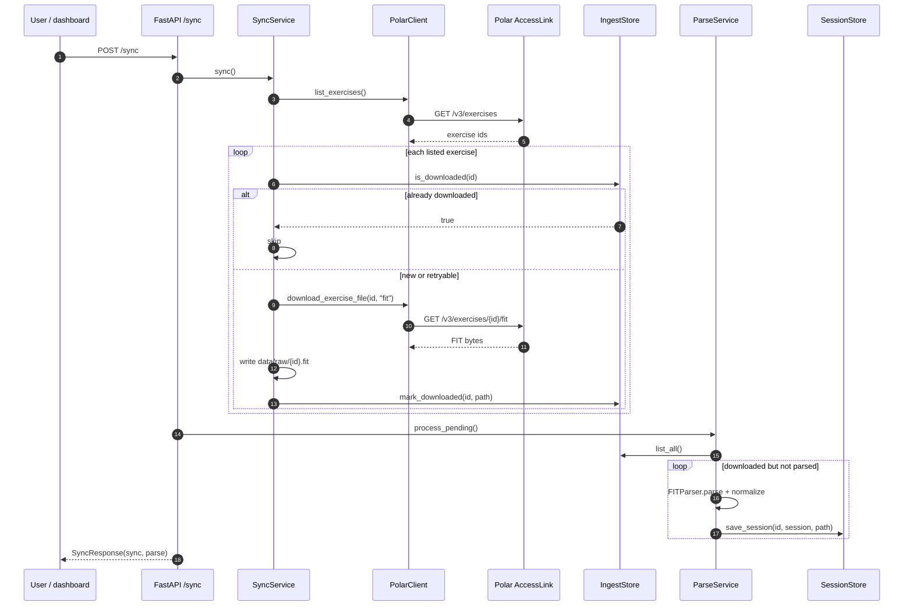
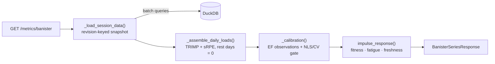

# Architecture — Athlete Stress Sim

> **Document version:** 1.2.0 · **Product version:** 1.0.0 · **Status:** Final · **Last updated:** 2026-11-19
>
> **Audience:** maintainers, reviewers and anyone evaluating the engineering
> design of the project. This document describes the as-built architecture of
> `v1.0.0`, including its boundaries, data flows, design decisions, failure
> modes and known technical debt. It is not a line-by-line API reference: FastAPI
> generates the interactive contract at `/docs`.

---

## Table of contents

1. [Purpose and scope](#1-purpose-and-scope)
2. [Architecture at a glance](#2-architecture-at-a-glance)
3. [System context](#3-system-context)
4. [Runtime topology](#4-runtime-topology)
5. [Component architecture](#5-component-architecture)
6. [Data model](#6-data-model)
7. [Data flows](#7-data-flows)
8. [Computational core](#8-computational-core)
9. [Persistence and caching](#9-persistence-and-caching)
10. [API layer and contracts](#10-api-layer-and-contracts)
11. [Frontend architecture](#11-frontend-architecture)
12. [Configuration](#12-configuration)
13. [Security and privacy](#13-security-and-privacy)
14. [Failure handling and observability](#14-failure-handling-and-observability)
15. [Deployment and CI](#15-deployment-and-ci)
16. [Design decisions and trade-offs](#16-design-decisions-and-trade-offs)
17. [Testing strategy](#17-testing-strategy)
18. [Known limitations and technical debt](#18-known-limitations-and-technical-debt)
19. [Extension points](#19-extension-points)
20. [Related documents](#20-related-documents)

---

## 1. Purpose and scope

Athlete Stress Sim is a personal, local-first training-load platform. It ingests
Polar telemetry, stores it in DuckDB, computes physiological load and
fitness-fatigue metrics, and exposes them through a FastAPI backend and a Dash
dashboard.

This document answers four questions:

- **What are the system boundaries?** Which components exist, who owns which
  data and where do processes communicate?
- **How does data move?** From Polar authorization and FIT ingestion to daily
  load, model outputs and dashboard panels.
- **Why is it built this way?** The trade-offs behind local storage, catch-up
  sync, NLS calibration, batch caching and the separate frontend.
- **What are the limits?** Failure modes, security assumptions and technical debt
  that a maintainer must know before extending the system.

The code remains the authoritative source. This document explains the intended
architecture and records where the implementation intentionally deviates from a
more conventional layered design.

---

## 2. Architecture at a glance

| Concern | Choice | Primary reason |
| --- | --- | --- |
| Runtime | Two processes: FastAPI backend + Dash frontend | Clear service boundary; frontend consumes an HTTP contract instead of DuckDB |
| Ingestion | Idempotent Polar catch-up sync + FIT parsing | No public HTTPS endpoint is required for a local, single-user deployment |
| Storage | One local DuckDB file | Embedded OLAP, zero server operations, local privacy |
| Computation | Pure Python modules for metrics and models | Testability and reuse across API, simulations and tests |
| Calibration | NLS with fixed `tau`, bounded ridge and CV gate | The joint EKF problem was not identifiable with the available data |
| API | FastAPI + Pydantic v2 | Typed request/response contracts and generated OpenAPI docs |
| UI | Plotly Dash + Mantine, dark theme | Information-dense dashboard with server-side data access |
| Deployment | Docker Compose, runtime-only images | Reproducible local deployment without baking data or secrets |
| Quality | ruff + mypy + pytest + coverage gate | Consistent style, strict typing on `src` and an 80 % core-coverage gate |

---

## 3. System context



The athlete interacts only with the browser. The Dash process fetches data from
the backend using a server-side HTTP client. The browser does not read DuckDB and
does not need to call the backend directly, so the architecture does not rely on
browser CORS configuration.

The only external service is Polar AccessLink, used for OAuth2 and FIT download.
All biometric data remains in the local DuckDB file and the local raw-data
directory.

---

## 4. Runtime topology

| Component | Runtime | Port | State | Responsibility |
| --- | --- | --- | --- | --- |
| Backend | Uvicorn + FastAPI | `8000` | DuckDB file, process-local snapshot cache, in-memory OAuth state | OAuth2, ingestion, metrics, simulations, prediction |
| Frontend | Dash development server or Python module | `8050` | Browser-side `dcc.Store` values only | Layout, callbacks, panels and charts |
| Database | DuckDB library, not a server | — | `data/athleta.duckdb` | Sessions, samples, RPE, ingest state, tokens |
| Raw files | Local filesystem | — | `data/raw/<exercise_id>.fit` | Downloaded FIT payloads |
| External API | Polar AccessLink v3 | HTTPS | Remote | Exercise listing, summaries and FIT files |

In local development, `make run-backend` starts Uvicorn with `--reload` and
`make run-frontend` starts the Dash app. In Docker, both processes run in
separate containers, share the `data/` volume, and the frontend reaches the
backend at `http://backend:8000`.

DuckDB is embedded and uses a **single-writer** model. The backend is the
intended writer during normal operation; the optional `make db` shell is a
maintenance tool. Long-running writes from two processes can contend for the
database lock.

---

## 5. Component architecture



### 5.1 Package responsibilities

| Package | Responsibility | Notable modules |
| --- | --- | --- |
| `backend/api/` | HTTP routers, dependency wiring and status-code mapping | `oauth.py`, `ingest.py`, `exercises.py`, `metrics.py`, `prediction.py` |
| `backend/schemas/` | Pydantic request/response contracts shared with the frontend | `exercises.py`, `ingest.py`, `metrics.py`, `prediction.py` |
| `backend/config.py` | Environment-backed settings and physiological priors | `PhysiologicalConfig`, `PolarConfig`, `StorageConfig` |
| `backend/main.py` | FastAPI application, lifespan startup sync, `/health` and `/config/physiology` | `app`, `lifespan`, `main()` |
| `core/etl/` | Polar OAuth2, AccessLink client, catch-up sync, FIT parsing, normalization and sport classification | `polar_oauth.py`, `polar_client.py`, `sync_service.py`, `fit_parser.py`, `normalize.py`, `parse_service.py`, `sports.py` |
| `core/storage/` | DuckDB schema creation and persistence | `session_store.py`, `ingest_store.py`, `token_store.py` |
| `core/metrics/` | Load and performance calculations | `trimp.py`, `rpe.py`, `load.py`, `acwr.py`, `decoupling.py`, `performance.py`, `taper.py`, `race_prediction.py` |
| `core/models/` | Fitness-fatigue model and parameter calibration | `banister.py`, `calibration.py` |
| `frontend/` | Dash app, HTTP client, shared theme, readiness and panels | `app.py`, `api.py`, `theme.py`, `readiness.py`, `components/` |
| `tests/` | Unit, integration, frontend and performance tests | `tests/helpers/fit_fixture.py`, API tests, metric tests |
| `docker/` | Runtime images and Compose topology | `Dockerfile.backend`, `Dockerfile.frontend`, `docker-compose.yml` |

### 5.2 Dependency directions and intentional coupling

The project is **not strictly layered**. Three couplings are deliberate or
accepted:

1. `core/etl/` imports `backend.config` for Polar settings. This keeps a single
   configuration model but inverts the usual core-to-backend direction.
2. `frontend/` imports `backend.schemas` and `core` types so both services share
   the same contracts.
3. `backend/api/prediction.py` reuses the private helpers
   `_assemble_daily_loads`, `_calibration`, `_load_session_data` and
   `_SessionData` from `backend/api/metrics.py`. This avoids duplicating the
   expensive snapshot/calibration path, at the cost of coupling two routers.

Any refactor that moves these modules must preserve those dependencies or
introduce a shared application service layer first.

### 5.3 Component boundaries

- **Metrics and models are pure functions.** `core/metrics` and `core/models` do
  not import DuckDB or FastAPI. They operate on `SampleLike`, dates, load lists
  and `BanisterParams`, which makes them easy to unit test.
- **Storage owns SQL.** No metric function queries DuckDB. The API assembles a
  snapshot, then passes plain data into the computational core.
- **The frontend does not read DuckDB.** It talks to the backend over HTTP, so
  the database can move or be replaced without changing the UI.
- **Pydantic is used at process boundaries.** The hot path uses lightweight
  `SampleRow` tuples instead of constructing a Pydantic `Sample` for every
  second of every session.

---

## 6. Data model



> DuckDB does not enforce these foreign keys. The relationships are logical and
> maintained by the application. `ATHLETE` is a single-row table for user zero,
> and `OAUTH_TOKENS` represents the latest active token set rather than a
> per-user token table.

### 6.1 Table catalog

| Table | Key | Main columns | Purpose |
| --- | --- | --- | --- |
| `athlete` | `athlete_id` | `polar_user_id`, `created_at` | Single user-zero identity |
| `exercises` | `exercise_id` | sport, timestamps, duration, distance, heart rate, ascent/descent, file path | One row per ingested session |
| `samples` | `(exercise_id, ts)` logically | elapsed time, heart rate, speed, cadence, altitude, distance, `is_valid` | Second-by-second telemetry |
| `session_rpe` | `exercise_id` | RPE, `recorded_at` | Session-RPE for strength sessions |
| `ingest_log` | `exercise_id` | file path, format, status, error, epoch | Idempotency and pending-work queue |
| `oauth_tokens` | latest row by `updated_at_epoch` | access/refresh tokens, scope, expiry | Polar OAuth2 token set |

The only explicit index is `samples_exercise_id_idx` on `samples(exercise_id)`,
which keeps per-session and batch sample queries predictable.

### 6.2 Data conventions

- **Dates:** daily load is keyed by the calendar date of the FIT `start_time`.
  There is no timezone conversion in the daily aggregation; a session belongs to
  the date reported by Polar.
- **Missing values:** telemetry fields can be `NULL`. Invalid samples are kept
  with `is_valid = false` instead of being dropped, so gaps remain visible to
  analysis code.
- **Units:** duration is stored in seconds, distance in meters, speed in meters
  per second and heart rate in bpm. Presentation converts to minutes, kilometers
  and pace.
- **Schema creation:** each store runs `CREATE TABLE IF NOT EXISTS` on
  initialization; `SessionStore` also creates the `samples(exercise_id)` index.
  There is no migration tool.
- **Write timestamps:** `created_at`, `parsed_at` and `recorded_at` are stored as
  naive UTC for persistence; token and ingest timestamps use epoch columns for
  ordering.

---

## 7. Data flows

### 7.1 OAuth2 account linking

1. `GET /auth/login` creates a single-use opaque `state` value in an in-memory
   store with a 600-second TTL and redirects the browser to Polar.
2. Polar redirects to `GET /auth/callback` with an authorization code and the
   state value.
3. The callback validates and consumes the state. An invalid or expired state
   returns HTTP 400.
4. `PolarOAuthClient` exchanges the code using HTTP Basic authentication with the
   client id and secret. PKCE is not used because AccessLink is a confidential
   client.
5. The client registers the user with `POST /users` using the access token. A
   `409 Conflict` means the user was already registered and is accepted.
6. `TokenStore` persists the access token, refresh token, scope, expiry and user
   id in DuckDB.
7. Later Polar requests ask `TokenManager` for a valid token. Tokens are
   refreshed automatically when they expire within five minutes; `/auth/refresh`
   forces a refresh.

The OAuth state store is process-local. A backend restart invalidates pending
login attempts, which is acceptable for a local single-user deployment.

### 7.2 Catch-up sync and FIT parsing



The same pipeline runs once at backend startup when
`POLAR_SYNC_ON_STARTUP=true`. The lifespan handler dispatches it with
`asyncio.to_thread`, so the event loop keeps serving health checks while the
download and parse work runs in a worker thread.

Important behavior:

- **Idempotency:** `SyncService` skips exercises whose ingest status is
  `downloaded`. Re-running `/sync` does not re-download known files.
- **Per-exercise isolation:** a download failure marks the exercise as `failed`
  and continues with the rest. A failed download can be retried on a later sync.
- **Parse retry:** a parse failure does not mark the exercise as parsed. Its
  ingest record remains `downloaded`, so `process_pending()` retries it next time.
- **Replacement:** `SessionStore.save_session` deletes any previous samples and
  exercise row for the id, then inserts the new session and samples.
- **30-day window:** Polar lists exercises from the last 30 days. Older sessions
  already stored locally remain available but are not re-downloaded.
- **Raw files:** downloaded FIT payloads are written to
  `data/raw/<exercise_id>.fit` and are never committed.

### 7.3 Metric computation



The metrics endpoints share one snapshot path:

1. `_load_session_data` fetches all exercises with RPE and all samples using two
   batch queries. It caches the result per database revision.
2. `_assemble_daily_loads` dispatches each session to the correct load function:
   - strength → Foster session-RPE;
   - running and elliptical → Banister TRIMP from heart-rate samples;
   - other activities with valid heart-rate samples → TRIMP as well;
   - sessions without the required inputs contribute no load.
3. `daily_load_series` aggregates multiple sessions per day and fills rest days
   with `0.0`.
4. `_calibration` computes running efficiency-factor observations and fits the
   Banister gains with fixed `tau` values and a cross-validation gate.
5. `impulse_response` produces the exact daily fitness, fatigue, performance and
   freshness series.

Endpoint-specific computation:

| Endpoint | Additional computation |
| --- | --- |
| `GET /metrics/trimp/{id}` | Per-session load only; uses the single-session sample query |
| `GET /metrics/acwr` | EWMA acute/chronic and risk-zone classification |
| `GET /metrics/banister` | Calibration + exact impulse response |
| `GET /metrics/calibration` | Calibration diagnostics and effective parameters |
| `GET /metrics/running-baseline` | Recent four-week running volume, pace and RPE |
| `GET /metrics/decoupling/{id}` | Per-kilometer EF and first/second-half decoupling |
| `GET /metrics/best-efforts` | Best running efforts per reference distance, fitness-adjusted |
| `POST /metrics/race-prediction` | Riegel, critical speed or HR extrapolation |
| `POST /simulate` | Exact impulse response over caller-provided loads |
| `POST /simulate/taper` | History + planned sessions, projected forward |
| `POST /simulate/taper/plan` | Generated taper sessions, projected to race morning |

Elliptical sessions contribute load to ACWR and Banister but are excluded from
running-only paths through `is_running` checks. Decoupling is computed per
exercise; the dashboard only offers running sessions in its selector.

### 7.4 Dashboard interaction and cache invalidation

1. The app loads once through a one-shot `dcc.Interval`.
2. **Refresh** calls `MetricsClient.sync()` first, then reloads every panel from
   the API. If sync fails, the dashboard still reloads local data and shows a
   sync-error alert.
3. The **RPE pending** modal posts to `/exercises/{id}/rpe`. Saving increments a
   Dash refresh counter; the dashboard reloads the metrics.
4. The **Session data** editor patches `/exercises/{id}`. A successful edit also
   triggers a metric reload.
5. Planned sessions in the What-if simulator are kept in a browser-side
   `dcc.Store`; the authoritative projection is recomputed by the backend on
   **Simulate**.

On the backend, every `SessionStore` write bumps its write counter. The next
metrics read sees a different revision and reloads the snapshot. Writes made by a
different store or process are detected through the database file's modification
time and size.

---

## 8. Computational core

| Concern | Module | Approach |
| --- | --- | --- |
| Session load dispatch | `core/metrics/load.py` | Strength → sRPE; all other activities with HR samples → TRIMP |
| Running/elliptical TRIMP | `core/metrics/trimp.py` | Exponential Banister weighting integrated per sample |
| Strength load | `core/metrics/rpe.py` | `RPE × duration_min` |
| Daily aggregation | `core/metrics/load.py` | Sum per date; fill rest days with zero |
| Efficiency factor | `core/metrics/decoupling.py` | `speed / HR`, per sample or per kilometer |
| Fitness-fatigue model | `core/models/banister.py` | Exact daily recurrence; `solve_ivp` cross-check |
| Calibration | `core/models/calibration.py` | Fixed `tau`, bounded ridge least squares, leave-one-out CV gate |
| ACWR | `core/metrics/acwr.py` | EWMA acute 7 d / chronic 28 d; risk zones |
| Taper plan | `core/metrics/taper.py` | Four-week baseline, linear volume factors, weekday placement |
| Race prediction | `core/metrics/race_prediction.py` | Riegel, critical speed and HR extrapolation |

The computational core is intentionally independent of persistence and HTTP. It
takes plain inputs (samples, dates, load lists, parameters) and returns plain
outputs. This is what makes the test suite fast and deterministic.

The calibration path is the most delicate part of the system. It is described
fully in [`mathematical-model.md`](mathematical-model.md); architecturally, it has
three important properties:

- `tau_1` and `tau_2` are fixed at the priors, so the fit is a bounded linear
  least-squares problem rather than a jointly identified nonlinear one.
- The fit is accepted only if it beats the prior-shaped baseline in
  leave-one-out cross-validation and explains enough in-sample variance.
- Failure is non-fatal: the caller receives the priors and diagnostics instead
  of an error.

---

## 9. Persistence and caching

### 9.1 DuckDB access pattern

- Every store opens a **new connection per operation** and closes it in a
  `finally` block. There is no connection pool.
- Each store creates its tables on construction; `SessionStore` also creates the
  `samples(exercise_id)` index. Initializing a new database therefore requires no
  migration step.
- The three stores share the same database file but own different tables:
  - `SessionStore`: `athlete`, `exercises`, `samples`, `session_rpe`;
  - `IngestStore`: `ingest_log`;
  - `TokenStore`: `oauth_tokens`.
- Writes use parameterized SQL. `SessionStore.update_exercise` accepts only an
  allow-listed set of columns, so dynamic `UPDATE` construction cannot be used
  to inject SQL identifiers.

### 9.2 Snapshot cache

The metrics path uses a process-local snapshot cache:

```text
revision = (resolved path, file mtime_ns, file size, write counter)
cache[path] = (revision, exercises-with-rpe, samples-by-exercise)
```

- The cache holds one snapshot per database path, up to eight paths.
- A read reuses the snapshot only when the revision matches exactly.
- The write counter changes after local writes (parse, RPE, session edit).
  External writes are caught by the file modification time and size.
- The cache is **not shared across processes**. With multiple Uvicorn workers,
  each worker holds its own copy. Correctness is preserved by the revision key,
  but memory use is duplicated. The Docker deployment runs a single backend
  worker.

### 9.3 Why the hot path avoids Pydantic

Parsing one year of second-by-second telemetry can produce hundreds of thousands
of rows. Constructing a Pydantic model for every row would dominate the request
time. Batch queries therefore return `SampleRow` named tuples, which satisfy the
`SampleLike` protocol and are consumed directly by the metric helpers. Pydantic
is reserved for API boundaries and session-level models.

### 9.4 Performance envelope

The S15 optimization work introduced batch reads, the `SampleRow` type, the
`samples(exercise_id)` index and the revision cache. Measured locally and
reported in [`validation.md`](validation.md):

- warm dashboard load: from ~5.5 s to ~0.32 s;
- warm metric endpoints: below 200 ms; the first cold request includes the
  snapshot load and can exceed this target;
- ODE simulation: below the 0.5 s requirement.

These are local single-user measurements, not a load test. They are sufficient
for the intended deployment and are documented as such.

---

## 10. API layer and contracts

### 10.1 Routers

| Router | Prefix | Endpoints |
| --- | --- | --- |
| OAuth | `/auth` | `/login`, `/callback`, `/status`, `/refresh` |
| Ingestion | — | `POST /sync`, `GET /sync/status` |
| Exercises | `/exercises` | list, detail, `POST /{id}/rpe`, `PATCH /{id}` |
| Metrics | `/metrics` | `trimp/{id}`, `acwr`, `banister`, `calibration`, `ekf`, `running-baseline`, `decoupling/{id}` |
| Prediction | `/metrics` | `best-efforts`, `race-prediction` |
| Simulation | — | `POST /simulate`, `POST /simulate/taper`, `POST /simulate/taper/plan` |
| System | — | `GET /health`, `GET /config/physiology` |

`GET /metrics/ekf` is a deprecated alias of `GET /metrics/calibration`. The
alias remains for backward compatibility with early clients.

### 10.2 Contracts and validation

- Request and response bodies are Pydantic v2 models in `backend/schemas/`.
- FastAPI validates inputs and generates OpenAPI documentation at `/docs`.
- `POST /simulate/taper/plan` rejects a race date on or before the last recorded
  session with HTTP 422.
- `GET /exercises/{id}` and the decoupling/RPE endpoints return HTTP 404 for an
  unknown exercise id.
- `GET /metrics/running-baseline` returns `null` when there are not enough valid
  running sessions.
- `GET /auth/status` masks the access token; the full token is never returned.
- `PATCH /exercises/{id}` exposes only metadata fields and rejects unknown
  columns in the store.

### 10.3 Dependency wiring

FastAPI dependencies use `lru_cache(maxsize=1)` singletons for the token store,
OAuth client, ingest store, session store, sync service and parse service. The
service objects are therefore shared for the process lifetime. The metrics
module keeps its own process-local snapshot cache.

The OAuth `StateStore` is also process-local and in-memory. This is acceptable
for a single-user local deployment but would not work behind a load balancer
without shared state.

### 10.4 Status-code mapping

| Condition | Response |
| --- | --- |
| Polar account not linked | `400` from `/sync`; run `/auth/login` first |
| Polar API error after retries | `502` from `/sync` |
| Invalid/expired OAuth state | `400` from `/auth/callback` |
| No refresh token | `400` from `/auth/refresh` |
| Unknown exercise id | `404` |
| Invalid request body or race date | `422` from FastAPI/Pydantic |
| Unhandled server failure | `500` |

---

## 11. Frontend architecture

The Dash process is a **server-side consumer** of the backend API:

- `MetricsClient` uses `httpx2`, resolves `API_URL` from the environment and
  defaults to `http://localhost:8000`.
- The browser never talks to the backend or DuckDB directly.
- `app.py` builds a Mantine `AppShell` with a dark theme and three top-level
  tabs: **Today**, **Trends** and **Plan**.
- `Plan` contains internal pills: **Race taper**, **What-if** and **Race
  predictor**.
- Callbacks are synchronous and build panels on demand. The initial load is a
  one-shot `dcc.Interval`; subsequent updates use the Refresh button, the RPE
  modal or the session editor.
- Browser-side `dcc.Store` values hold planned sessions and refresh counters,
  not authoritative training data.

Presentation concerns are separated from computation:

- `theme.py` owns color tokens, spacing, Mantine theme configuration and the
  shared Plotly layout.
- `readiness.py` turns freshness into a readiness level and percentile; this is
  presentation logic, not an API concern.
- `components/` contains pure panel builders (status, ACWR, fitness chart,
  freshness, quick stats, decoupling, simulator, taper, prediction, sessions and
  RPE).

Error handling is fail-soft:

- If the API is unreachable, `MetricsClient` raises `MetricsClientError`.
- The dashboard shows a **Backend offline** alert and empty panels; local data
  is not deleted.
- A failed sync shows **Sync failed.** but the dashboard still reloads from the
  local database.
- Empty states are explicit (`No data yet`, `No training history yet`,
  `No sessions yet`).

The dashboard is single-user and synchronous. Long-running Polar syncs happen
behind the Refresh action; the UI waits for the backend response rather than
implementing a background job queue.

---

## 12. Configuration

Configuration is loaded with `pydantic-settings` from environment variables and
a `.env` file in the current working directory.

| Prefix / variable | Loaded by | Purpose |
| --- | --- | --- |
| `POLAR_CLIENT_ID`, `POLAR_CLIENT_SECRET` | `PolarConfig` | Polar OAuth2 credentials |
| `POLAR_REDIRECT_URI` | `PolarConfig` | Must match the registered callback exactly |
| `POLAR_AUTHORIZE_URL`, `POLAR_TOKEN_URL`, `POLAR_API_URL`, `POLAR_SCOPE` | `PolarConfig` | OAuth2 and AccessLink endpoints |
| `POLAR_MEMBER_ID` | `PolarConfig` | Partner member id used during user registration |
| `POLAR_SYNC_ON_STARTUP` | `PolarConfig` | Enables the lifespan catch-up sync |
| `ATHLETE_HR_MAX`, `ATHLETE_HR_REST`, `ATHLETE_SEX` | `PhysiologicalConfig` | TRIMP defaults and coefficients |
| `ATHLETE_TAU_1`, `ATHLETE_TAU_2`, `ATHLETE_K_1`, `ATHLETE_K_2`, `ATHLETE_P0` | `PhysiologicalConfig` | Banister priors |
| `ATHLETE_DB_PATH` | `StorageConfig` | DuckDB file path |
| `ATHLETE_RAW_DATA_DIR` | `StorageConfig` | Raw FIT directory |
| `API_URL` | `MetricsClient` | Backend base URL used by the frontend |
| `DASH_DEBUG` | Dash entry point | Enables/disables Dash debug mode |

`.env` is git-ignored. `.env.example` documents the variables and contains no
real credentials. The Compose backend service reads `.env` when present, and the
frontend receives `API_URL=backend:8000`.

The user-zero reference values in `.env.example` match the code defaults:
`HR_max=200`, `HR_rest=60`, `tau_1=42` and `tau_2=7`.

---

## 13. Security and privacy

### 13.1 Security controls

- **Local-first data:** biometric data and raw FIT files stay on the local
  filesystem. They are not sent anywhere except the Polar API used for ingestion.
- **OAuth state:** `/auth/login` issues a random, single-use `state` with a
  600-second TTL; the callback rejects invalid or expired values.
- **Token handling:** `/auth/status` masks the access token. Full tokens are
  never returned by the API.
- **SQL safety:** queries are parameterized, and the only dynamic column list is
  a strict allow-list in `update_exercise`.
- **Secrets hygiene:** `.env` is git-ignored, Docker images contain no data or
  secrets, `.pre-commit` includes `detect-private-key`, and tests use synthetic
  FIT fixtures.
- **Screenshot hygiene:** real dashboard captures must be reviewed and sanitized
  before publication (`RNF-01`).

### 13.2 Security assumptions and limitations

- **No authentication on the API or dashboard.** The system is designed for a
  single trusted user on localhost or a trusted network. Do not expose ports
  `8000` or `8050` to the public internet.
- **No TLS or reverse proxy is configured.** Add one if the services are moved
  off localhost.
- **OAuth tokens are stored in plaintext** in DuckDB. At-rest encryption is not
  implemented; the current control is filesystem permissions on `data/` and
  `.env`.
- **No rate limiting on the local API.** Polar rate limits are handled on the
  outbound client, not on inbound requests.
- **No multi-user authorization.** The `athlete` table is a single row and the
  token store keeps one active token set.

---

## 14. Failure handling and observability

| Failure | Behavior | Recovery |
| --- | --- | --- |
| Polar account not linked | `/sync` returns 400; startup sync skips | Run `/auth/login` |
| Polar 429/5xx or transport error | Exponential backoff, `Retry-After` support, up to four retries, then 502 | Retry later; local data remains |
| Per-exercise download failure | Marked `failed`, remaining exercises continue | Next sync retries |
| FIT parse failure | Record stays `downloaded`; error logged; other files continue | Next parse pass retries |
| Dashboard API unreachable | Offline alert; empty panels | Start backend, press Refresh |
| Sync failure in dashboard | Sync-error alert; local metrics still load | Check Polar link/network, retry |
| Calibration gate failure | Priors returned with diagnostics | Add data or inspect `/metrics/calibration` |
| Invalid race date | HTTP 422 | Choose a date after the last session |
| DuckDB lock contention | Connection error | Stop the competing writer (`make db` or another process) and retry |
| Backend restart during login | In-memory OAuth state is lost | Start the login flow again |

Observability is intentionally lightweight:

- Python logging for startup ingestion, downloads and parse failures;
- Uvicorn access/error logs;
- `ingest_log` as the durable audit of download/parse state;
- `/sync/status` counters for downloaded, failed, total and parsed sessions;
- `/health` for liveness;
- no metrics endpoint, tracing or structured log aggregation.

The startup sync runs with `asyncio.to_thread`. Shutdown cancels the awaiting
asyncio task, but a blocking HTTP call already running in the worker thread may
finish in the background; the process should be allowed to exit normally.

---

## 15. Deployment and CI

### 15.1 Local development

```bash
make install
make run-backend    # Uvicorn with --reload on :8000
make run-frontend   # Dash on :8050
make db             # interactive DuckDB shell
```

The backend and frontend use the same `src/` package and the same local `data/`
directory. The frontend resolves the backend at `http://localhost:8000` unless
`API_URL` is set.

### 15.2 Docker Compose

```text
docker/docker-compose.yml
├── backend  :8000  ← docker/Dockerfile.backend
│   ├── env_file: ../.env (optional)
│   ├── volume: ../data → /app/data
│   └── healthcheck: GET /health every 30 s
└── frontend :8050  ← docker/Dockerfile.frontend
    ├── API_URL=http://backend:8000
    └── depends_on: backend (healthy)
```

Both images install only runtime dependencies with
`uv sync --frozen --no-dev`; application code is copied after the dependency
layer. No database, raw FIT files or secrets are baked into the images. The data
directory is mounted so the container can read and write the local database.

### 15.3 CI

GitHub Actions runs on pushes to `main`, `develop` and `feature/**` and on PRs to
`main`/`develop`. The quality job:

1. checks out the repository;
2. installs `uv` and Python 3.12 with caching;
3. runs `uv sync --all-groups --frozen`;
4. runs `make lint`;
5. runs `make typecheck`;
6. runs `make test-cov`.

The coverage gate is **80 % branch coverage over `src/athlete_stress_sim/core`**.
Backend and frontend modules are excluded from that gate. The workflow uses a
concurrency group that cancels superseded runs and has read-only repository
permissions.

### 15.4 Release state

The `v1.0.0` documentation, screenshot and secret-review checklist is complete.
The release is tagged and published. The public README and technical deep dives
are part of it.

---

## 16. Design decisions and trade-offs

| Decision | Rationale | Trade-off |
| --- | --- | --- |
| Local DuckDB instead of a server database | Zero operations, strong local privacy, excellent analytical performance for one user | Single writer, no built-in multi-user or migration story |
| Catch-up sync instead of webhooks | No public HTTPS endpoint is needed; works from a laptop | Ingestion is pull-based and limited to Polar's 30-day listing |
| NLS with fixed `tau` instead of a joint EKF | The joint problem was ill-conditioned; fixed time constants and a CV gate are stable and explainable | Individual time constants cannot adapt to the athlete |
| Bounded ridge toward prior shape | Prevents unstable gain estimates on short, noisy series | Shrinks the fit toward the prior; extreme athletes may need longer history |
| Fail-soft calibration | The dashboard always has usable parameters | Users may not realize priors are active unless they inspect `/metrics/calibration` |
| Combined TRIMP + sRPE scale | One daily series is required for ACWR and Banister | Running and strength loads are not physiologically equivalent |
| Batch snapshot cache | Repeated dashboard requests avoid per-session queries | Process-local memory and duplicated caches with multiple workers |
| Server-side frontend HTTP client | The dashboard cannot corrupt DuckDB and the API contract stays explicit | One extra network hop and a synchronous dependency on the backend |
| Pydantic at boundaries, `SampleRow` internally | Type safety without constructing models for every telemetry second | Two representations of sample data |
| Single-user, no API auth | Simplifies a personal local deployment | Must never be exposed to an untrusted network |
| In-memory OAuth state | Simple, single-use CSRF protection with no extra storage | Lost on restart and not shared across workers |

---

## 17. Testing strategy

| Layer | What is tested | Technique |
| --- | --- | --- |
| ETL | FIT parsing, normalization and sport classification | Synthetic in-memory FIT fixtures; no real biometric data |
| Polar clients | OAuth2 exchange, retries and download behavior | `httpx2.MockTransport` injected into clients |
| Storage | Schema creation, session/RPE/token persistence | Temporary DuckDB files via `tmp_path` |
| Metrics | TRIMP, sRPE, ACWR, EF, decoupling, taper and race prediction | Hand-calculated references and synthetic series |
| Models | Banister recurrence, `solve_ivp` cross-check and calibration gate | Synthetic loads/observations and edge cases |
| API | Route contracts, status codes and end-to-end flows | Temporary databases and injected services |
| Frontend | Panel builders, callbacks and offline/empty states | Fake `MetricsClient` and component tests |
| Quality | Lint, typing and coverage | `ruff`, `mypy --strict` on `src`, `pytest-cov` |

`tests/conftest.py` forces `POLAR_SYNC_ON_STARTUP=false` so importing the backend
never triggers a network-bound startup sync. No test requires an external
service or network access.

Known test-boundary details:

- mypy is strict but only checks `src`; tests are not type-checked.
- coverage measures `src/athlete_stress_sim/core` only.
- FIT fixtures are generated in memory by `tests/helpers/fit_fixture.py`; real
  FIT files and the DuckDB database are never committed.

---

## 18. Known limitations and technical debt

- **No database migrations.** Tables are created ad hoc with
  `CREATE TABLE IF NOT EXISTS`; the samples index uses
  `CREATE INDEX IF NOT EXISTS`. A schema change requires a manual migration or a
  rebuild of the local database.
- **No multi-user model.** `athlete` is a single row and `oauth_tokens` stores
  the latest token set. Adding users requires schema, API, token and UI changes.
- **No API authentication or TLS.** The deployment assumes localhost or a
  trusted network.
- **Plaintext token storage.** OAuth tokens are stored in DuckDB without at-rest
  encryption. Filesystem permissions are the current control.
- **Process-local caches and OAuth state.** Multiple backend workers would each
  keep their own snapshot and state; the Docker deployment uses one worker.
- **Non-transactional replacements.** `SessionStore.save_session` and
  `TokenStore.save` use delete-then-insert without an explicit transaction. A
  crash between statements could leave a partial replacement.
- **DuckDB single-writer contention.** Opening `make db` during a write-heavy
  sync can contend for the database lock.
- **Layer inversion and shared private helpers.** `core/etl` depends on
  `backend.config`, `frontend` depends on backend schemas/core types, and the
  prediction router imports private helpers from the metrics router.
- **No structured observability.** Logs and `ingest_log` exist, but there are no
  metrics, traces or correlation ids.
- **No webhook ingestion.** Polar's 30-day listing is the only discovery path.
- **Calibration may stay on priors.** With short or noisy histories the gate
  fails by design; the dashboard then shows prior-shaped curves.

---

## 19. Extension points

| Goal | Where to extend |
| --- | --- |
| Add a new sport family | `core/etl/sports.py`, load dispatch in `core/metrics/load.py`, exercise filters and UI selectors |
| Add a metric | Pure function in `core/metrics/`, schema in `backend/schemas/`, router in `backend/api/`, panel in `frontend/components/` |
| Add a race model | `core/metrics/race_prediction.py` plus prediction schemas and UI options |
| Change the data model | `core/storage/*_store.py`; introduce a migration mechanism first |
| Support multiple users | Add user ids to tables, per-user token scoping, API auth and UI account selection |
| Add webhook ingestion | FastAPI endpoint, shared ingestion service and a public HTTPS deployment |
| Encrypt tokens at rest | `core/storage/token_store.py` and key management |
| Improve observability | Structured logging, request ids, metrics and tracing around API and sync |
| Scale beyond one process | Shared cache/state, a database server and a job queue for ingestion |

---

## 20. Related documents

- [`product-requirements.md`](product-requirements.md) — product scope, requirement IDs and acceptance criteria.
- [`roadmap.md`](roadmap.md) — phases, sprints, risks and delivery status.
- [`user-guide.md`](user-guide.md) — dashboard interpretation, configuration and troubleshooting.
- [`mathematical-model.md`](mathematical-model.md) — derivations, calibration objective and references.
- [`validation.md`](validation.md) — real-data validation, calibration diagnostics and performance.
- [`README.md`](../README.md) — public overview and quick start.
- [`CONTRIBUTING.md`](../CONTRIBUTING.md) — development workflow and contribution guidelines.
- [`SECURITY.md`](../SECURITY.md) — security model, reporting and privacy expectations.
- [`CHANGELOG.md`](../CHANGELOG.md) — release history.
- [`LICENSE`](../LICENSE) — MIT license.

> The code remains the source of truth for exact signatures and constants. This
> document is the architectural map; the mathematical model document owns the
> derivations.
